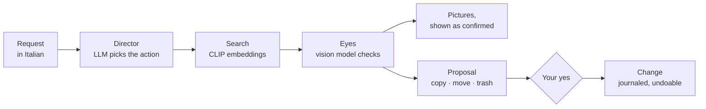

# Regista

A private assistant for photos and music that runs entirely on your own PC and Android phone, with local AI models only.

You ask in Italian, as you would ask a person — *"trovami le foto con un cane dell'estate scorsa"* (find the photos with a dog from last summer), *"fammi gli album dei viaggi"* (make an album for each trip) — and Regista finds, sorts and moves your pictures. It changes nothing without your yes, and every change can be undone. Nothing leaves your devices: no cloud, no account, no API key. *Regista* is Italian for *director*.

## What it does

- **Finds photos** by what they show, when and where they were taken: "un cane nero", "le foto del Giappone di maggio", "dal 20 maggio al 20 luglio".
- **Tidies them up**: copies, moves or trashes them, finds duplicates, makes an album for each trip, shows them by kind (people, animals, landscapes, food, documents…). Each change is proposed first, with the pictures in front of you.
- **Works on the phone too**: an Android app searches the phone's own photos even offline, asks the PC's model when at home, moves photos both ways and copies the new ones to the PC by itself.
- **Plays music** on the PC and on the phone, also with the screen off and from a home-screen widget; copies songs both ways, and adds songs from any folder of the phone, WhatsApp included. No AI here.

## How the AI works

- **The director** is a small LLM running locally in Ollama: Qwen3.5 4B, or Granite 4.1 3B on lighter PCs. It reads the request and fills in a JSON form constrained by a schema (structured output): search, count, copy, move, trash, undo, or just answer. Free text from the model can never trigger an action. Dates and places are read by plain rules, because small models get them wrong, and the reply is written by the app from the actual results, so no number is made up. On 99 requests in Italian it picked the right action 98 times.
- **Search by meaning.** Each picture is turned once into an embedding by CLIP (ViT-B/32); the request is embedded by a multilingual sentence model trained to land in the same space, so Italian works without translation. Both are quantized ONNX models, 220 MB together, that run on the CPU of the PC and of the phone alike: that is what lets the phone search offline.
- **The eyes.** Embeddings mix up similar things, so the likeliest pictures are then shown one by one to the vision part of the same Qwen model: "Does this photo show a dog? Answer yes or no." Only confirmed pictures are shown, each as soon as it is confirmed. On 10 requests over 200 sample pictures, 98% of the pictures shown were right.
- **No model where rules or numbers are enough.** Kinds come from comparing each picture's embedding with averaged descriptions of each kind; duplicates from embeddings together with a perceptual hash; trips from GPS positions and dates, with the places named from GeoNames.
- **Fitted to the machine.** Regista measures the PC (graphics card, memory), runs a short self-test of the installed models and picks the one that did best there, then keeps it loaded in video memory, so that the first picture shows up within seconds.

## Privacy and safety

- Everything runs locally: the models in Ollama and ONNX Runtime, the page on 127.0.0.1 only.
- A model never touches a file. It can only propose; the change happens after your yes. Nothing is deleted (trashed pictures go to a folder), and every change is journaled and can be undone.
- The phone pairs with the PC the way WhatsApp links a computer: a QR code on the PC, the same six-digit number on both screens, a yes on the PC. The connection is encrypted with a pinned certificate, and the phone keeps its key locked in the Android Keystore.

## Built with

Python (FastAPI) · TypeScript and React · Kotlin (Android) · Ollama · ONNX Runtime

## Run it

On Windows 10 or 11 (64-bit, 8 GB of memory), double-click `install.cmd`: it measures the PC, chooses the model, lists what it would download and asks once, then leaves an icon on the desktop. `.\android.ps1 build` builds the phone app, which pairs from the PC's page under «Telefono».

Tests: `pytest` and `.\npm.ps1 test`. How each part works, how to develop it, and everything that was measured: [docs/notes.md](docs/notes.md).

## Status

A personal project, tried on a laptop with a 4 GB RTX 3050 Ti, an Android 7 tablet and Android 13 and 15 emulators. Its security was reviewed only by its author. Away from home the phone reaches the PC only through a private network such as Tailscale.

## Credits

Places from [GeoNames](https://www.geonames.org/) (CC BY 4.0) and country names in Italian from [Unicode CLDR](https://cldr.unicode.org/). Models: CLIP (OpenAI), clip-ViT-B-32-multilingual-v1 (sentence-transformers), Qwen3.5 (Alibaba Cloud), Granite 4.1 (IBM).
